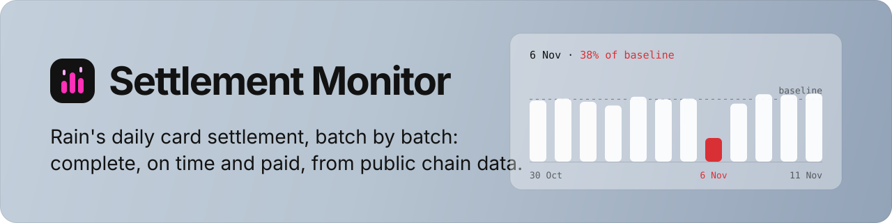
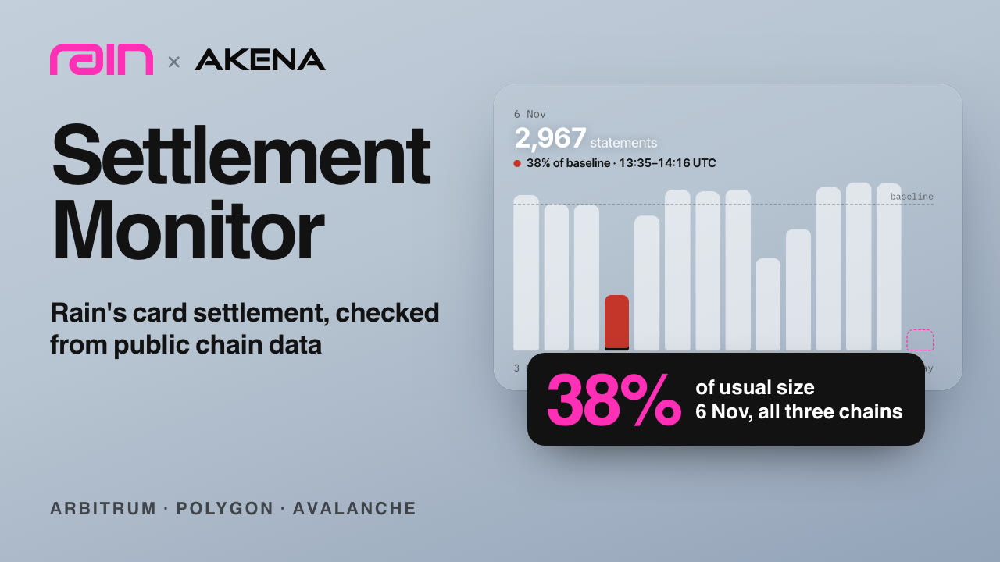

<p align="center">
  
</p>

Dashboard that follows Rain's daily onchain card settlement on Arbitrum, Polygon and Avalanche, from public chain data only. Every batch is checked against its own 14-day baseline: did it arrive complete, on time, and get paid?

## How it works

1. **Indexer** (`scripts/index.ts`). Reads `StatementPublished` (both Coordinator versions), `Liquidation` and `Withdrawal` logs from Rain's Coordinators on Arbitrum, Polygon and Avalanche over free public RPCs. It writes a decoded local cache to `cache/`. The cache is gitignored, because it holds tx hashes.
2. **Aggregator** (`scripts/aggregate.ts`). Turns the cache into aggregate snapshots in `public/data/`: counts, batch windows, latency histograms and pending ages. `assertNoIdentifiers` rejects any tx hash, statement key or non-Coordinator address before a file is written.
3. **Core** (`src/core/`). Pure, tested logic: batch clustering, settlement and latency, baselines, and the four alert rules.
4. **UI** (`src/ui/`). A static React page with the overview, batch completeness, daily close ledger, latency and alerts. Open `?intro` for the step-by-step intro: click, Space or → to advance, Esc to skip.

## Demo

[](docs/demo.mp4)

[Watch the demo (1.5 min, mp4, narrated)](docs/demo.mp4)

## Events and units

- `StatementPublished`: old topic `0x81b3d178…` and Coordinator 2.04 topic `0x31c1d5ba…`, which adds a `liquidationAddress`. A scanner that knows only the old topic silently misses every 2.04 Coordinator.
- `Liquidation`: `0x8ffbf5b0…`. Join rule: `Liquidation.topic3 == StatementPublished.topic1` on the same Coordinator. A statement is settled when Σ `netAmountCents` ≥ the closing balance. Empty-collateral retries (0 cents) count as attempts.
- USD = cents / 100. This was checked against the ERC-20 transfers of USDC and USDT liquidations on several chains.
- Batches: statements more than 45 min apart start a new batch, and the largest batch of a UTC day is the primary one. A group's baseline is the median of its previous 14 primary batches within 28 days, excluding days already flagged short.
- Batch rules fire once a batch has closed (45 min without a new statement), as they would live, not at its last statement.
- Every threshold is a named demo objective in `src/core/thresholds.ts`.

## Run

```bash
pnpm install
pnpm dev                                          # http://localhost:5173
pnpm typecheck && pnpm lint && pnpm test
pnpm index --chain arbitrum --from 2026-10-13     # refresh the local cache
pnpm aggregate                                    # rebuild public/data
pnpm run deploy                                   # static site on Cloudflare
```

## Not yet

- Base, BSC, Optimism and Ethereum coverage. Base needs a paid RPC.
- Live polling and real webhooks. Alerts are replayed over indexed days.
- Per-program mapping with Rain's own labels. Coordinators appear as group letters; their public contract addresses are listed in the Methodology panel.

---

Independent prototype by [Akena](https://akena.co) · Public onchain data · Not affiliated with Rain.
